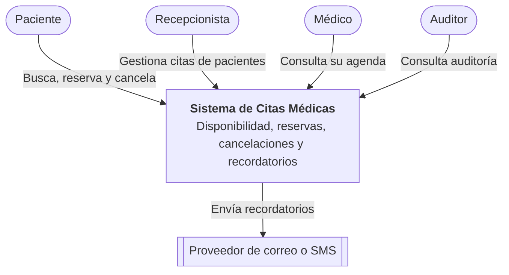
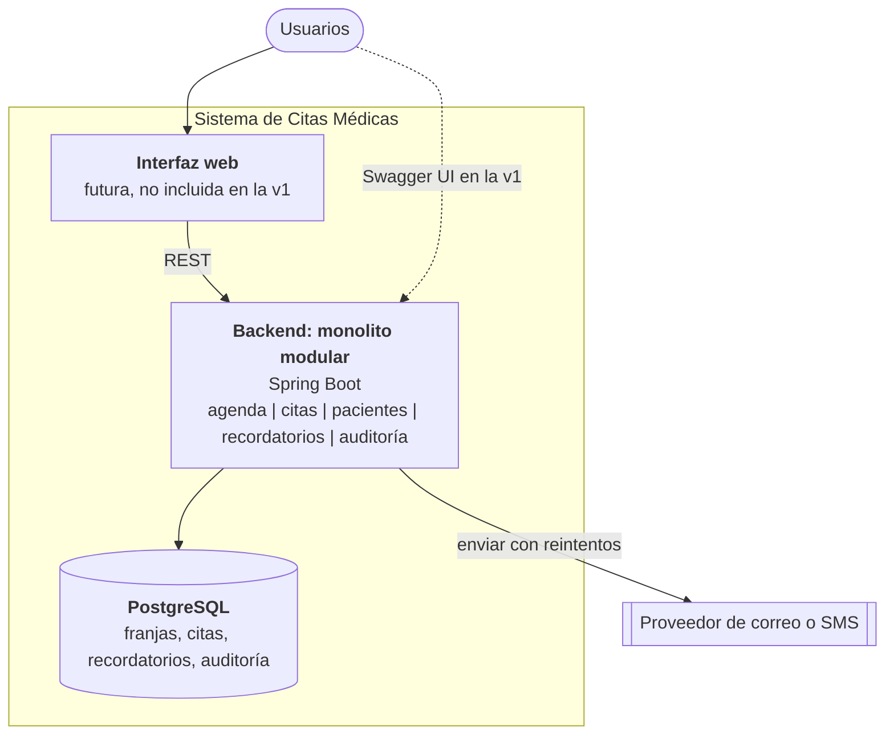
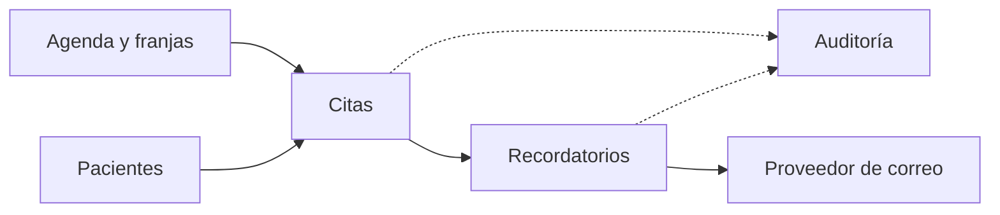
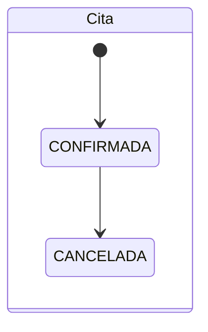
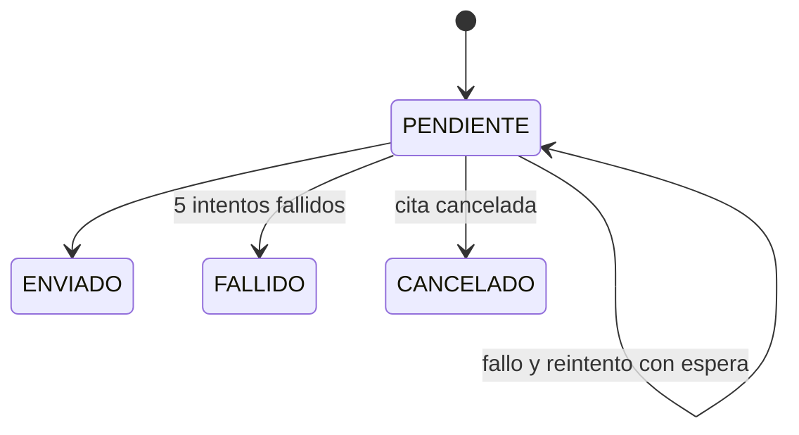
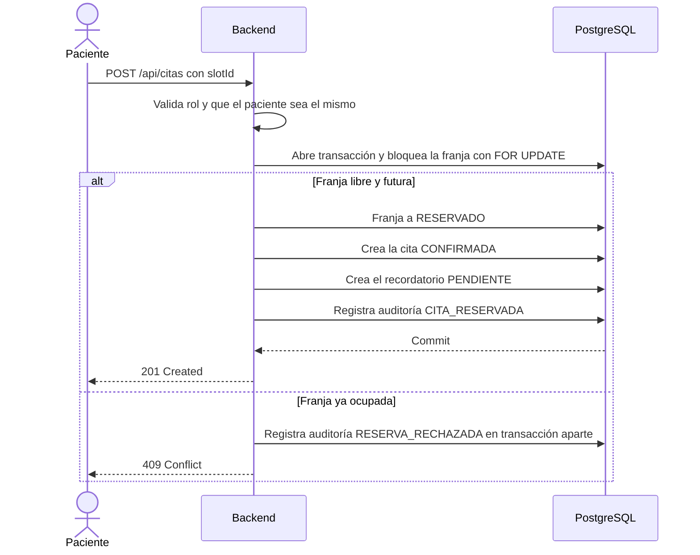
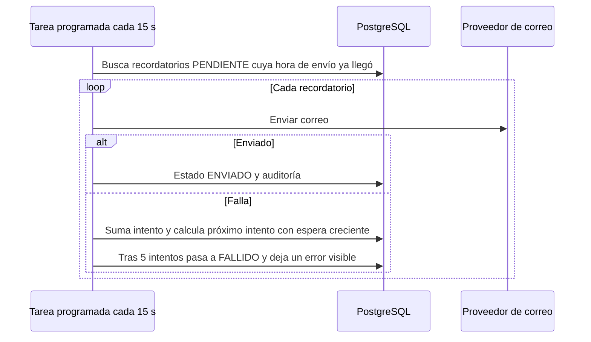

# Caso 3 — Citas médicas

Sistema para una clínica que hoy administra citas por teléfono y hojas de cálculo. Permite buscar disponibilidad, reservar, cancelar y enviar recordatorios, sin reservas duplicadas.

## 1. Objetivo, actores y alcance

**Objetivo:** eliminar reservas duplicadas, reducir ausencias con recordatorios confiables y dejar trazabilidad de cada acción.

| Actor | Rol |
|---|---|
| Paciente | Busca horarios, reserva y cancela sus propias citas |
| Recepcionista | Reserva y cancela a nombre de cualquier paciente |
| Médico | Consulta y cancela las citas de su propia agenda |
| Auditor | Consulta el historial de acciones |
| Proveedor de correo o SMS | Sistema externo que entrega los recordatorios |

**Dentro del alcance:** disponibilidad, reserva, cancelación, recordatorios con reintentos, control de acceso por rol y auditoría.

**Fuera del alcance (v1):** autenticación real, reprogramación, lista de espera, historia clínica, pagos, frontend, SMS.

## 2. Requisitos

**Funcionales**
- RF1. Buscar horarios libres por profesional y fecha.
- RF2. Reservar un horario libre para un paciente.
- RF3. Cancelar una cita y liberar el horario.
- RF4. Enviar un recordatorio 24 horas antes de la cita.
- RF5. Reintentar los recordatorios que fallen y marcar los que no se pudieron entregar.
- RF6. Restringir quién puede ver, modificar o cancelar cada cita.
- RF7. Registrar en auditoría cada acción, incluidos los intentos rechazados.

**Calidad**
- Consistencia: un horario nunca queda reservado dos veces.
- Privacidad: solo datos de contacto, sin información clínica.
- Disponibilidad: una caída del proveedor de correo no bloquea reservas ni cancelaciones.
- Idempotencia: cancelar dos veces la misma cita no cambia el resultado.
- Rendimiento: búsqueda de disponibilidad con p95 menor a 500 ms.
- Trazabilidad: auditoría solo de inserción.

## 3. Diagramas C4

### Nivel 1: Contexto



### Nivel 2: Contenedores



### Módulos internos



### Estados





## 4. Flujo de una operación crítica: reservar una cita



### Envío de recordatorios con reintentos



## 5. Decisiones y stack

**¿Cómo se impide que dos personas reserven el mismo horario?**
- Cada horario es una **franja** (`slot`) con restricción única por profesional e inicio.
- Al reservar, la transacción bloquea la fila de la franja con `SELECT ... FOR UPDATE`. La segunda solicitud espera, ve la franja ocupada y recibe 409.
- Es la base de datos quien garantiza la exclusión, no el código de la aplicación.

**¿Qué datos médicos se guardan y cuáles no?**

| Se guarda (mínimo necesario) | No se guarda |
|---|---|
| Nombre, documento, correo y teléfono | Diagnósticos |
| Profesional y especialidad | Historia clínica |
| Fecha y hora de la cita | Síntomas o notas clínicas |
| Tipo genérico de consulta (ej. "Control general") | Resultados de exámenes |

El motivo de cancelación es un texto corto y no debe incluir información de salud.

**¿Quién puede ver, modificar o cancelar una cita?**

| Rol | Reservar | Ver | Cancelar | Auditoría |
|---|---|---|---|---|
| Paciente | Solo para sí mismo | Solo las suyas | Solo las suyas | No |
| Recepcionista | Para cualquiera | Todas | Todas | No |
| Médico | No | Las de su agenda | Las de su agenda | No |
| Auditor | No | No | No | Sí |

En la v1 el rol se simula con los headers `X-Rol` y `X-Usuario-Id`. En producción se reemplaza por Spring Security con JWT.

**¿Cómo se reintenta un recordatorio que no se pudo enviar?** Los recordatorios viven en una tabla con estado, número de intentos y hora del próximo intento. Una tarea programada reintenta con espera creciente (30, 60, 90 y 120 s). A los 5 intentos queda `FALLIDO`, con error en el log y en auditoría, para que recepción llame al paciente. Si se cancela la cita, el recordatorio se cancela.

**¿Qué información queda en la auditoría?**

| Dato | Ejemplo |
|---|---|
| Quién actuó | PACIENTE:1, RECEPCION, SISTEMA |
| Acción | CITA_RESERVADA, CITA_CANCELADA, RESERVA_RECHAZADA, RECORDATORIO_ENVIADO, RECORDATORIO_REINTENTO, RECORDATORIO_FALLIDO |
| Entidad e id | CITA 12 |
| Detalle mínimo | slotId, motivo, número de intentos |
| Fecha y hora | Marca de tiempo |

| Tecnología | Justificación |
|---|---|
| Spring Boot (Java 21) | Estándar del curso y un monolito modular simple |
| PostgreSQL | Transacciones y bloqueo de filas para evitar duplicados |
| REST + OpenAPI (Swagger UI) | Contrato claro y pruebas manuales sin frontend |
| Docker Compose | Entorno reproducible en Codespaces |
| Proveedor de correo tras una interfaz | Se puede cambiar por SMS u otro sin tocar el dominio |
| RabbitMQ | No se usa: un solo proceso asíncrono, resuelto con una tabla de recordatorios |

## 6. ADR

### ADR-001 (arquitectónica): Franjas con bloqueo de fila en un monolito modular
- **Estado:** aceptada
- **Contexto:** hoy hay reservas duplicadas. Un solo servidor y una sola base de datos bastan para la clínica.
- **Decisión:** modelar la disponibilidad como franjas y reservar bajo un bloqueo pesimista dentro de una transacción. Todo en un monolito modular.
- **Consecuencias:** imposible duplicar por diseño y con pocos componentes. Costo: el bloqueo serializa reservas de la misma franja, lo cual es aceptable por el bajo volumen.
- **Alternativas descartadas:** bloqueo optimista (obliga a reintentar y es más difícil de explicar) y microservicios (complejidad sin beneficio).

### ADR-002 (tecnológica): Recordatorios con tabla y reintentos en lugar de un broker de mensajes
- **Estado:** aceptada
- **Contexto:** hay un único proceso asíncrono y un solo proveedor de correo, y los recordatorios no pueden perderse.
- **Decisión:** guardar cada recordatorio en PostgreSQL y procesarlo con una tarea programada con reintentos. El proveedor de correo queda detrás de una interfaz.
- **Consecuencias:** el recordatorio se crea en la misma transacción que la cita, así que nunca se pierde, y no hay un componente extra. Costo: sondeo periódico y menos escalable que un broker.

## 7. Riesgos

| Riesgo | Mitigación |
|---|---|
| Proveedor de correo caído o lento | Reintentos con espera creciente, estado FALLIDO visible y alerta para llamar al paciente |
| Fuga de datos personales | Mínimo de datos, sin información clínica, control por rol y auditoría. A futuro, TLS y cifrado en reposo |
| Control de acceso débil (roles simulados por headers) | Reemplazar por Spring Security con JWT antes de producción y probar los permisos por rol |

**Limitación conocida:** las horas usan la zona del servidor. Una clínica real debe guardar la zona horaria explícita.

## 8. Métricas

**Negocio:** citas duplicadas (meta: 0). Complementarias: ausencias, tiempo para encontrar un turno y recordatorios entregados.

**Técnica:** porcentaje de recordatorios entregados al primer intento. Complementaria: latencia p95 de `GET /api/disponibilidad` (menor a 500 ms).

---

## Estado de la implementación

| Componente | Estado |
|---|---|
| Disponibilidad, reserva sin duplicados, cancelación idempotente, roles, recordatorios con reintentos, auditoría | Implementado |
| Autenticación | Simulada con headers `X-Rol` y `X-Usuario-Id` |
| Proveedor de correo | Simulado (`CorreoSimulado`): `falla@` siempre falla, `reintento@` falla 2 veces |
| Frontend, SMS, reprogramación, lista de espera, zona horaria | No incluido |

## Cómo ejecutar

```bash
docker compose up --build -d
docker compose ps
docker compose logs -f backend
docker compose down
```

- En Codespaces abre el panel **Ports** y haz clic en el globo del puerto 8080.
- La raíz `/` muestra enlaces. Swagger UI: `/swagger-ui/index.html`. Salud: `/api/health`.
- Roles: `PACIENTE`, `RECEPCION`, `MEDICO`, `AUDITOR` (headers `X-Rol` y `X-Usuario-Id`).
